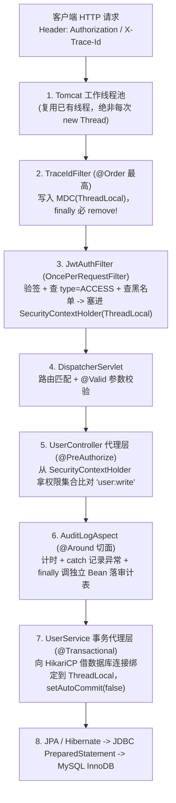
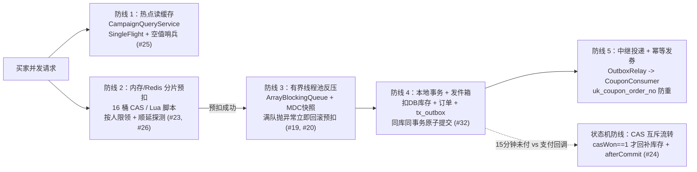

# 模块 7 地基图谱：从 Java 单文件实验到 Spring Boot 生产工程

> **写给觉得「看框架代码心里发虚、基础不牢」的你**：
> 很多同学学完 Java 语法和并发小实验，一打开 Spring Boot 项目就发懵——满屏的 `@Component`、`OncePerRequestFilter`、`@PreAuthorize`、`@Transactional`、`Specification`，感觉代码不是自己调的，全是框架在「暗箱操作」。
>
> **其实 Spring Boot 里没有任何魔法**。它只是把你在前几个模块学过的 **反射、动态代理、`ThreadLocal`、线程池、JDBC 事务和并发容器** 组装成了一条固定的流水线。先把下面这 **5 张底层透视图** 刻进脑子里，再去敲项目 A 和项目 B，每一行代码都会变得无比踏实。

---

## 一、一张图看懂：一个 HTTP 请求在项目 A 里到底穿过了几层「门卫」？

当你用 Postman 或前端发送 `POST /api/users`（带 `Authorization: Bearer xxx` 和 `X-Trace-Id: t-001`）时，Tomcat 从线程池里借出 **1 条工作线程**，按下面这条严格顺序从外往里穿洋葱，再原路返回：



### 你必须抓牢的 3 个「地基真相」：
1. **为什么不用传参，`UserController`、`AuditLogAspect`、日志框架全都知道「当前是谁、traceId 是多少、用的是哪条数据库连接」？**
   - 全靠 **`ThreadLocal`**！
   - `MDC` 底层是 `ThreadLocal<Map<String, String>>`；
   - `SecurityContextHolder` 默认底层是 `ThreadLocal<SecurityContext>`；
   - Spring `@Transactional` 的 `TransactionSynchronizationManager` 底层也是好几个 `ThreadLocal`（存当前线程借出来的 JDBC `Connection`）！
   - **推论 1（必考坑）**：因为 Tomcat 线程会复用，凡是你自己塞进 `ThreadLocal`/`MDC` 的东西，**不在 `finally` 里 `remove()` 就一定会串给下一个请求**（去跑 `FoundationPitfallDrillsTest#drill01` 亲眼验证）。
   - **推论 2（必考坑）**：一旦你在业务里开了异步线程 `CompletableFuture.runAsync(..., pool)`，**新线程的 `ThreadLocal` 是空的**！既拿不到 `traceId`，也拿不到外层的 `@Transactional` 数据库事务！（去跑 `SeckillFoundationDrillsTest#drill01` 亲眼验证）。

---

## 二、Spring 的「动态代理洋葱圈」：为什么自调用和默认事务传播会坑死人？

新手最容易犯的错，是以为 `@Transactional`、`@PreAuthorize`、`@Audited` 是「改写了你的 `.class` 字节码」。**错！你的原始类一行都没变**。Spring IoC 容器在启动时，用 **CGLIB（或 JDK Proxy）** 在你的原始对象（`target`）外面包了一层「替身外壳（`proxy`）」：

```text
调用方注入拿到的引用 ──▶ [ UserService$$SpringCGLIB$$0 (代理外壳) ]
                             │ 1. DataSourceTransactionManager.getTransaction() -> conn.setAutoCommit(false)
                             ▼
                        [ UserService 原始对象 (target) ]
                             │ 2. 执行你的业务 SQL
                             ▼
                        回到代理外壳：没抛 RuntimeException 就 commit()，抛了就 rollback()
```

### 地基推论（项目 A 与项目 B 为什么这么分包分层的根本原因）：
1. **为什么项目 A 要专门拆出 `AuditLogPersistenceService` 并加 `Propagation.REQUIRES_NEW`？**
   - 假设业务方法贴了 `@Transactional` + `@Audited`，执行一半抛了异常。
   - 如果审计日志直接用默认的 `Propagation.REQUIRED` 保存，它会**复用外层那个已经被标记为 rollback-only 的数据库连接**——等异常往外抛完，业务数据和你的「失败审计日志」**一起回滚蒸发了**！
   - 拆成独立 Bean 并贴上 `REQUIRES_NEW` 后，Spring 事务管理器会先把外层的脏事务**挂起（suspend）**，从连接池再借**第 2 条全新的 JDBC 连接**把 `success = false` 的审计日志先 `commit()` 落袋为安，然后再恢复外层事务去 `rollback()`。（去跑 `FoundationPitfallDrillsTest#drill04` 打断点看两条连接！）
2. **为什么项目 B 要专门拆出 `SeckillOrderPersistenceService`？**
   - 在 `SeckillService.claimOptimized()` 的异步任务里需要把「扣 DB 库存 + 插订单 + 插 `tx_outbox` 本地消息」包进同一个数据库事务。
   - 如果写在 `SeckillService` 自己里面用 `this.persistOrderAndOutbox(...)` 调用，就直接走了原始对象的 `this`，**完全绕过了外面的事务代理外壳**！万一插完订单在插 `tx_outbox` 时宕机或报错，订单提交了而消息没写进去，账就彻底平不了了！

---

## 三、JPA / Hibernate 地基：为什么严禁无脑 `FetchType.EAGER`？

很多初学者一遇到 `LazyInitializationException: could not initialize proxy - no Session`，就在网上搜个偏方把 `@ManyToMany` 改成 `FetchType.EAGER`，还把 `spring.jpa.open-in-view` 留成 `true`。这是典型的**「掩耳盗铃」**：

| 配置组合 | 机盖底下发生了什么 | 后果 |
|---|---|---|
| `open-in-view: true`（Spring 默认） | 数据库连接直到整个 HTTP JSON 序列化完才归还 HikariCP | 一旦渲染或网络慢，10 个连接瞬间耗尽，全站卡死 |
| `FetchType.EAGER` | 查 1 页 20 个 `SysUser` 时，Hibernate 先跑 1 条查用户 SQL，再循环跑 **20 条查角色 SQL**（N+1 灾难） | 接口随每页条数线性变慢 |
| **本项目标准做法**：<br/>`open-in-view: false` + `LAZY` + `@BatchSize(50)` + Service 层转 `Record VO` | 1 条 `SELECT ... LIMIT 10` 查用户 + 1 条 `WHERE user_id IN (?, ?, ...)` 批量拉角色；在 `@Transactional(readOnly = true)` 结束前组装成不可变 `UserVO` | **总共恒定 2～3 条 SQL**，连接用完立刻归还连接池，且绝不报懒加载异常 |

---

## 四、高并发秒杀全链路地基：项目 B 是怎么把 32 节并发课焊成一台机器的？

如果你单看项目 B 的类觉得乱，对照下面这张**「五道防线流水线」**——你会发现每一个组件都精准对应你学过的一节实验课：



### 重点咀嚼两个「一知半解最容易写错」的细节：
1. **为什么关单回补库存必须同时满足「`casWon == 1`」和「`afterCommit()`」？**
   - 假设订单 `SK-01` 处于 `PENDING`，此时两个线程同时触发 `closeTimeout("SK-01")`。
   - SQL `UPDATE seckill_order SET status='CLOSED' WHERE order_no='SK-01' AND status='PENDING'` 在 InnoDB 里会对 `order_no` 唯一索引加行锁：第一个线程改成功返回 `1`，第二个线程进来看到 `status` 已经是 `'CLOSED'`，匹配不到行返回 `0`。
   - **只有拿到返回值 `1` 的那个线程**才有资格执行 `remaining_stock + 1`！否则库存就凭空多出去了。
   - 更进一步：为什么分片缓存里的库存要在 `TransactionSynchronizationManager` 的 `afterCommit()` 里才 `+1`？因为如果数据库事务还没 `commit` 你就先把内存/Redis 库存 `+1` 了，新买家立刻冲进来抢走并去扣数据库库存，结果前一个事务回滚或还没提交可见，账就彻底乱了！
2. **为什么有了 `tx_outbox` 本地消息表，下游 `CouponFulfillmentConsumer` 还是必须写幂等唯一索引？**
   - `tx_outbox` 解决的是**「生产者不丢消息」**（At-Least-Once 至少投递一次）。
   - 但正因为是「至少投递一次」，当下游已经发完券、还没来得及把成功响应传回给 `OutboxRelayScheduler` 时网络闪断了，下一轮定时任务看到状态还是 `PENDING`，**一定会把同一条消息再发一遍**！
   - 所以**「生产者 Outbox 防丢 + 消费者 `uk_coupon_order_no` 唯一键防重」**是成对出现的黄金搭档，缺一半都不算真懂分布式一致性。

---

## 五、怎么用本仓库把基础真正练扎实？（强烈建议按此动作执行）

不要只用眼睛看代码！按下面 3 步动手，每一步大约 30～45 分钟：

1. **第一步：跑通并单步调试 10 个「踩坑对照演练」**
   - 打开项目 A 的 [`FoundationPitfallDrillsTest.java`](./project-a-admin/src/test/java/com/javahood/admin/drills/FoundationPitfallDrillsTest.java)（5 个演练）
   - 打开项目 B 的 [`SeckillFoundationDrillsTest.java`](./project-b-seckill/src/test/java/com/javahood/seckill/drills/SeckillFoundationDrillsTest.java)（5 个演练）
   - 在每个 `@Test` 的第一行打上断点（Debug 模式），看着变量一步步变化。
2. **第二步：做「故意破坏实验（Break-It Lab）」**
   - 跟着 [`project-a-admin/WORKSHOP_A.md`](./project-a-admin/WORKSHOP_A.md)（第 01～10 节）和 [`project-b-seckill/WORKSHOP_B.md`](./project-b-seckill/WORKSHOP_B.md)（第 11～20 节）里的**「动手破坏任务」**，亲手删掉某一行保护代码（比如删掉 `REQUIRES_NEW`、删掉 `MDC.remove`、删掉 `casWon != 1` 判断），运行 `mvn test` 看哪个测试当场爆炸，再亲手修回来。
3. **第三步：用交互式网页工作台做自测与 2 分钟脱稿讲题**
   - 双击打开 [`workshop-lab.html`](./workshop-lab.html)，逐节完成基础快问快答与 2 分钟面试口述训练。
